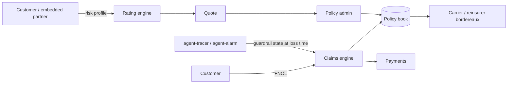

# Architecture — agent-insure

## 1. Scope
Errors & omissions cover for autonomous-agent mistakes: underwriting, binding, and claims adjudication.
**MVP:** explainable rating worksheet, policy book (JSON), rule-based claims with warranty, exclusion, deductible and aggregate-limit logic.
**Product:** MGA platform with carrier capacity, telemetry-based pricing, embedded cover via API.

## 2. System context

## 3. Rating model
`premium = limit × base_rate × action_exposure × spend_authority × (1 − guardrail_credit) × claims_history × deductible_credit`, with a minimum premium.
- action exposure: highest-risk action × (1 + 10% per extra action type)
- spend authority: 1 + min(spend_limit / limit, 1)
- guardrail credits are capped at 60% total, so controls can't price the risk to zero

## 4. Claims adjudication order
1. Policy found and active.
2. Incident type is covered.
3. Cause is not excluded (intentional misuse, unpatched known vulnerability, fines).
4. **Warranty check:** every guardrail declared at bind time must have been active at loss time.
5. `payout = min(loss − deductible, remaining aggregate)`.

Every decision returns its reasons, and every claim is appended to the policy history.

## 5. Design decisions
- **Guardrails are priced and warrantied.** Customers get credits for human approval or spend
  caps, and the claim is voided if those controls were off. This aligns incentives and is the core
  product insight. *Trade-off:* it requires trustworthy telemetry, so the product ingests guardrail
  state from tamper-evident logs rather than from customer attestation.
- **A deterministic worksheet** instead of an opaque model, because regulators require rate
  filings to be explainable.

## 6. Production architecture
- Rating and claims as versioned rule packs (rates are filed, so versions are immutable).
- Postgres for policies, claims and endorsements. Double-entry ledger for premium and payouts.
- Telemetry connector verifies guardrail state from signed agent-alarm and agentwarden audit exports.

## 7. Compliance
Licensed carrier or MGA partnership required. Claims handling timelines tracked per state rules.

## 8. Risks
Correlated losses (a model regression hits every insured at once) mean an aggregate exposure cap
per model or provider, and reinsurance.
